### 👋 About Me
- 🔭 Software Engineer building scalable apps
- 🌱 Learning **Java** & **Spring Boot**
- ☁️ Working with **AWS**, **Docker**, **Kubernetes**
- ⚡ Comfortable with **JavaScript**

### 🛠️ Tech Stack

### 📊 Stats

### 📬 Connect

